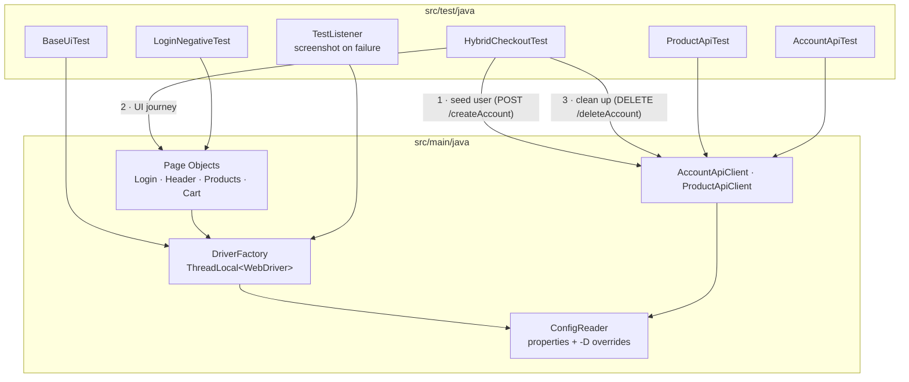

# Java Selenium + REST Assured Hybrid Framework

[](https://github.com/HiAvi-tester/java-selenium-restassured-hybrid/actions/workflows/maven-ci.yml)


A UI and API test framework for [Automation Exercise](https://automationexercise.com) built around one idea: **use the API for setup and teardown, and the browser only for what a user actually sees.** Each UI test creates its own user through the REST API, runs the journey in Selenium, and deletes the user afterwards, so tests are isolated, parallel-safe and leave no data behind.

---

## Architecture



## What's covered

| Suite | Tests | Highlights |
|---|---|---|
| **HybridCheckoutTest** (UI + API) | 3 | API-seeded login, search → add to cart → verify cart, logout/re-login |
| **LoginNegativeTest** (UI) | 2 (data-driven) | Unregistered email, wrong password |
| **AccountApiTest** (API) | 2 | Full account lifecycle, duplicate-email rejection |
| **ProductApiTest** (API) | 5 | Response shape, search relevance, 405 for wrong method, 400 for missing parameter, brands |

## Design decisions

| Decision | Why |
|---|---|
| **`ThreadLocal<WebDriver>`** in `DriverFactory` | `parallel="methods"` runs tests concurrently; each thread gets its own browser, and `remove()` prevents leaks in pooled threads |
| **Per-test user seeded via API** (and held in a `ThreadLocal`) | No shared accounts, no order dependency, and cleanup runs even if the test fails |
| **Explicit waits only**, implicit wait set to 0 | Mixing the two causes unpredictable timeouts; there is no `Thread.sleep` anywhere |
| **`ApiResult` wrapper** | This API always returns HTTP 200 with the real status in the body; tests assert on `responseCode`, so real errors can't pass silently |
| **URL navigation + JS-click fallback** | The demo site shows ads and interstitials that intercept clicks; this removes the main source of flakiness |
| **Allure with `@Step` and request/response capture** | A failed run shows the exact steps, API calls and a screenshot, enough to triage without re-running |
| **Selenium Manager** (no WebDriverManager) | Built into Selenium 4.6+; one fewer dependency to maintain |
| **Docker image** | Same browser and JDK everywhere, so "works on my machine" problems go away |

## Project structure

```
├── .github/workflows/maven-ci.yml   # headless run, Allure + Surefire artifacts
├── docs/
│   ├── Test-Plan-Summary.md         # scope, strategy, entry/exit criteria, risks
│   └── Defect-Triage-Matrix.md      # severity × priority, flaky-test handling, SLAs
├── src/main/java/com/framework/
│   ├── api/        # BaseApiClient, AccountApiClient, ProductApiClient, ApiResult
│   ├── config/     # ConfigReader
│   ├── driver/     # DriverFactory (ThreadLocal)
│   ├── model/      # TestUser record
│   ├── pages/      # BasePage, LoginPage, HeaderComponent, ProductsPage, CartPage
│   └── utils/      # TestDataFactory
├── src/main/resources/config.properties
├── src/test/java/com/framework/
│   ├── base/BaseUiTest.java
│   ├── listeners/TestListener.java
│   └── tests/      # HybridCheckoutTest, LoginNegativeTest, AccountApiTest, ProductApiTest
├── Dockerfile
├── testng.xml          # full suite, parallel="methods" thread-count="3"
├── testng-smoke.xml    # @smoke group only
└── pom.xml
```

## Running the tests

**Requirements:** JDK 17+, Maven 3.9+, Chrome or Firefox.

```bash
mvn test                                    # full suite, Chrome with a visible window
mvn test -Dheadless=true                    # headless
mvn test -Dbrowser=firefox                  # Firefox
mvn test -Dsuite=testng-smoke.xml           # smoke only
mvn allure:serve                            # open the Allure report
```

**Docker:**

```bash
docker build -t hybrid-tests .
docker run --rm -v "$PWD/target:/app/target" hybrid-tests
```

**CI:** every push and pull request runs the suite headless on GitHub Actions. Download the **allure-report** artifact from the run to see results. The smoke suite can also be started manually from the *Actions* tab.

## History

This repository started as my Selenium practice project in 2025 and was rebuilt into this framework. Earlier commits are kept to show the progression.

## Author

**Avinash Kumar Verma**: Senior Test Engineer · ISTQB certified · 9 years in QA, now focused on Java/Selenium, Playwright and API test automation.
