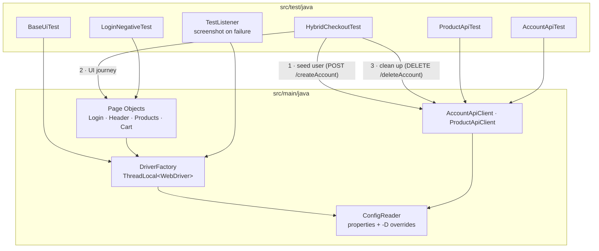

# Java Selenium + REST Assured Hybrid Framework

**UI and API test automation that sets up data through the API and uses the browser only for real user journeys, so tests are isolated, parallel-safe and leave no data behind.**

[](https://github.com/HiAvi-tester/java-selenium-restassured-hybrid/actions/workflows/maven-ci.yml)


### 📊 [Live test report (Allure)](https://hiavi-tester.github.io/java-selenium-restassured-hybrid/)

Published by CI on every push to `master`, including failed runs, so you can see exactly what broke and why.

<!--
  TODO: record docs/demo.gif (20–30 s) with ScreenToGif:
  terminal running `mvn test -Dheadless=true` → Allure dashboard (overview, a failed test with its screenshot and steps).
  Keep it under ~5 MB so GitHub renders it inline.
-->


---

## Problem

UI suites against a shared web app usually fail for reasons that have nothing to do with the feature under test:

- tests share one login account and break each other when run in parallel;
- setup (registering a user, filling a cart) is done through the browser, which is slow and adds flaky steps;
- leftover test data piles up and changes what later tests see;
- a red build gives you a stack trace, not the steps, requests and screenshot needed to triage.

## Approach

**API for setup, UI for journeys.** Each UI test creates its own user through the REST API, runs only the user-visible journey in Selenium, then deletes the user through the API, even when the test fails.



| Decision | Why |
|---|---|
| `ThreadLocal<WebDriver>` in `DriverFactory` | `parallel="methods"` gives each thread its own browser; `remove()` prevents leaks in pooled threads |
| Per-test user seeded via API | No shared accounts, no order dependency, cleanup runs even on failure |
| Explicit waits only (implicit wait = 0) | Predictable timeouts; no `Thread.sleep` anywhere |
| `ApiResult` wrapper | The API returns HTTP 200 with the real status in the body; tests assert on `responseCode` so errors can't pass silently |
| URL navigation + JS-click fallback | The demo site's ads and interstitials intercept clicks |
| Allure `@Step` + request/response capture + failure screenshot | A failed run can be triaged without re-running it |

**Coverage:** 12 test executions (11 methods, one data-driven ×2).

| Class | Layer | Tests | What it checks |
|---|---|---|---|
| `HybridCheckoutTest` | UI + API | 3 | API-seeded login, search → add to cart → verify cart, logout / re-login |
| `LoginNegativeTest` | UI | 2 (data-driven) | Unregistered email, wrong password |
| `AccountApiTest` | API | 2 | Full account lifecycle, duplicate-email rejection |
| `ProductApiTest` | API | 5 | Response shape, search relevance, 405 for wrong method, 400 for missing parameter, brands |

## Results

Measured locally on 2026-11-26: Windows 11, headless Chrome, `mvn -B clean test -Dheadless=true`. The tests run against the public demo site [automationexercise.com](https://automationexercise.com).

| Run | Tests (UI / API) | Passed | Failed | Skipped | Suite time | Wall clock |
|---|---|---|---|---|---|---|
| Full suite, parallel (`testng.xml`, 3 threads) | 12 (5 / 7) | 11 | 1 | 0 | 79 s | 92 s |
| Full suite, serial (same classes, `parallel="none"`) | 12 (5 / 7) | 9 | 3 | 0 | 120 s | 133 s |
| Smoke (`testng-smoke.xml`) | 3 (1 / 2) | 0 | 2 + 1 setup | 1 | 16 s | 27 s |

**Every failure above came from the live site, not from the tests.** The failure screenshots show the site's own page: *"This website is under heavy load (queue full)"*. In the smoke run the API returned non-JSON responses under the same load: both API tests failed, the UI test's API setup (`@BeforeMethod`) failed, and so the UI test was skipped. The assertions were left unchanged. Instead, the report shows the exact step, request and screenshot where the site stopped responding.

The serial run includes several 15 s wait timeouts caused by the overload, so serial vs parallel (133 s vs 92 s) is indicative only. The 📊 live report above shows the latest CI numbers.

## Tech stack

| Area | Tools |
|---|---|
| Language / build | Java 17, Maven |
| UI | Selenium 4.27 (Selenium Manager, Chrome/Firefox), Page Object Model |
| API | REST Assured 5.5, Jackson |
| Runner | TestNG 7.10 (parallel methods, groups, data providers) |
| Reporting | Allure 2.29 (steps, REST request/response, screenshots on failure) |
| CI / infra | GitHub Actions, GitHub Pages, Docker |

## Quick start

**Requirements:** JDK 17+, Maven 3.9+, Chrome.

```bash
mvn test -Dheadless=true       # full suite, headless Chrome
mvn allure:serve               # open the Allure report
```

More options:

```bash
mvn test                                  # visible browser
mvn test -Dbrowser=firefox                # Firefox
mvn test -Dsuite=testng-smoke.xml         # smoke group only
```

**Docker** (Chrome and JDK inside the image; results are written to `./target`):

```bash
docker build -t hybrid-tests .
docker run --rm -v "$PWD/target:/app/target" hybrid-tests
docker run --rm -v "$PWD/target:/app/target" hybrid-tests -Dsuite=testng-smoke.xml   # extra args are passed to mvn
```

## Project structure

```
├── .github/workflows/maven-ci.yml   # headless run, Allure + Surefire artifacts, Pages deploy
├── docs/
│   ├── Test-Plan-Summary.md         # scope, strategy, entry/exit criteria, risks
│   └── Defect-Triage-Matrix.md      # severity × priority, flaky-test handling, SLAs
├── src/main/java/com/framework/
│   ├── api/        # BaseApiClient, AccountApiClient, ProductApiClient, ApiResult
│   ├── config/     # ConfigReader
│   ├── driver/     # DriverFactory (ThreadLocal)
│   ├── model/      # TestUser record
│   ├── pages/      # BasePage, LoginPage, HeaderComponent, ProductsPage, CartPage
│   └── utils/      # TestDataFactory
├── src/main/resources/config.properties
├── src/test/java/com/framework/
│   ├── base/BaseUiTest.java
│   ├── listeners/TestListener.java
│   └── tests/      # HybridCheckoutTest, LoginNegativeTest, AccountApiTest, ProductApiTest
├── Dockerfile
├── testng.xml          # full suite, parallel="methods" thread-count="3"
├── testng-smoke.xml    # @smoke group only
└── pom.xml
```

## CI/CD

[`.github/workflows/maven-ci.yml`](.github/workflows/maven-ci.yml):

| Trigger | What runs |
|---|---|
| Pull request | Full suite headless; Allure report and Surefire results uploaded as build artifacts |
| Push to `master` | Same, and the Allure report is published to GitHub Pages, even if tests fail |
| Manual (*Actions → Run workflow*) | Choose `testng.xml` or `testng-smoke.xml` |

Before generating the report, the workflow pulls the previous report's `history/` from Pages, so the Allure **Trend** graph builds up across runs.

## QA documentation

- [Test Plan Summary](docs/Test-Plan-Summary.md): scope, strategy, entry/exit criteria, risks
- [Defect Triage Matrix](docs/Defect-Triage-Matrix.md): severity × priority, flaky-test handling, SLAs

## About me

**Avinash Kumar Verma – Senior QA Automation Engineer, 9 years**

- LinkedIn: [linkedin.com/in/iamavinashkumarverma](https://www.linkedin.com/in/iamavinashkumarverma)
